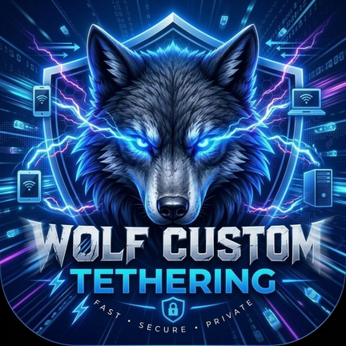

<p align="center">
  
</p>

<h1 align="center">Wolf Net Share</h1>

<p align="center">
  <strong>Wi-Fi tethering over a Shizuku-privileged test network with native Go datapath forwarding.</strong>
</p>

Creates a test TUN interface, sets it as the preferred tethering upstream, and forwards hotspot traffic through a high-performance Go datapath. Supports IPv4 and IPv6 routing without root.

---

## 🚀 Features

- 🌐 **Unlimited Hotspot:** Tethering traffic uses your main data plan instead of metered hotspot allowance.
- 🛡️ **VPN Compatible:** Share your active VPN connection (WireGuard, OpenVPN, etc.) with all connected clients.
- ⚙️ **Uses Existing Hotspot:** Uses standard Android Wi-Fi hotspot, USB, or Bluetooth tethering.
- 🙌 **No Root Required:** Requires only [Shizuku](https://shizuku.rikka.app/) (via wireless debugging or adb).
- 🎛️ **Quick Settings Tile:** Toggle hotspot sharing directly from your quick settings shade.
- 🤖 **Automation Ready:** Control sharing via Tasker, MacroDroid, or custom broadcast intents.

---

## 📋 Requirements

- **Android 11+ (API 30+)** on an `arm64-v8a` device.
- **[Shizuku](https://shizuku.rikka.app/) 13.6.0+** running and authorized.
- Android 13+ works out of the box. Android 11 & 12 are supported via module verification (see `docs/android-compatibility.md`).

---

## 🛠️ Building from Source

### Prerequisites
1. **JDK 17** (e.g. Eclipse Temurin 17).
2. **Android SDK** with:
   - Compile SDK 35
   - Platform Tools
   - **NDK `27.0.12077973`**
3. **Go 1.23+** and **gomobile**:
   ```bash
   go install golang.org/x/mobile/cmd/gomobile@latest
   gomobile init
   ```

### Quick Build Steps
1. **Copy configuration templates:**
   ```bash
   cp local.properties.example local.properties
   ```
   Edit `local.properties` to point `sdk.dir` to your Android SDK path.

2. **Build Debug APK:**
   - **Linux / macOS:**
     ```bash
     ./gradlew assembleDebug
     ```
   - **Windows:**
     ```cmd
     gradlew.bat assembleDebug
     ```

3. **Output APK Location:**
   `app/build/outputs/apk/debug/app-debug.apk`

---

## 📦 GitHub Actions CI/CD

This repository contains fully configured GitHub workflows:
- **`.github/workflows/build.yml`**: Automatically compiles the Go datapath, builds debug APKs, and runs linting on every push or pull request.
- **`.github/workflows/release.yml`**: Signs and publishes release APKs when creating a git tag (e.g. `v0.4.0`).
